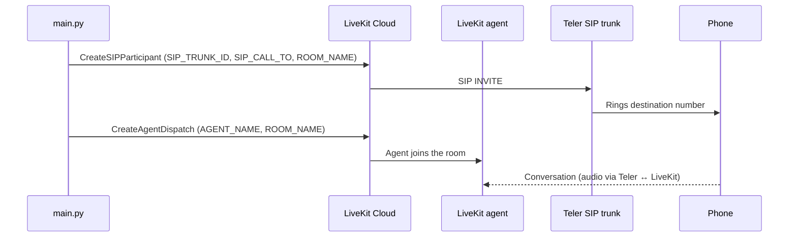

# LiveKit Outbound Calling (Frejun-Teler SIP)

[](LICENSE)  [](https://frejun.com/docs/teler/)

Simple plug-and-play outbound calling using:

* LiveKit Cloud (Agent created via UI)
* Frejun Teler SIP Trunk
* Python script

---

## What is Teler?

Teler is a programmable voice API by FreJun. It handles carriers, phone numbers, and real-time audio streaming so you can connect AI models directly to phone calls. → [FreJun-Teler](https://frejun.com/teler/)

---

## What you can build

- Outbound calls answered by a voice agent you built and deployed in LiveKit Cloud
- Campaign-style dialling, by running the script once per destination number
- A minimal starting point for LiveKit SIP outbound calling over Teler

## How it works



1. `main.py` loads settings from `.env` and creates a SIP participant in LiveKit using your outbound trunk.
2. LiveKit sends the call over the Teler SIP trunk, and Teler rings `SIP_CALL_TO`.
3. The script dispatches your deployed agent (`AGENT_NAME`) into the same room (`ROOM_NAME`).
4. When the callee answers, they talk to the agent. Audio flows between Teler and LiveKit over SIP.

## Prerequisites

Before running:

* LiveKit Cloud project
* Agent created & deployed in LiveKit UI
* SIP outbound configured in LiveKit
* Frejun-teler SIP trunk created
* LiveKit API Key + Secret
* LiveKit SIP trunk ID

you can setup your SIP trunk with Teler and Livekit by following the [Guide.](LiveKit_Cloud_Frejun_SIP_Integration_Guide.pdf)

### Runtime and network requirements

- **Runtime:** Python 3.10 or newer (`requires-python >= 3.10` in `pyproject.toml`).
- **Outbound internet access** from the machine running the script to your LiveKit Cloud project.
- A Teler SIP trunk reachable from LiveKit, configured as LiveKit's outbound trunk.
- See [Network requirements](https://frejun.com/docs/teler/telephony/network-requirements/) and [SIP trunking](https://frejun.com/docs/teler/telephony/sip-trunking/).

---

## Setup

### 1️⃣ Clone Repository

```bash
git clone https://github.com/frejun-tech/teler-livekit-outbound.git
cd livekit-outbound
```

---

### 2️⃣ Install Dependencies

```bash
pip install -r requirements.txt
```

---

### 3️⃣ Configure Environment Variables

Create a env file by copying the `.env.example` file to `.env`:

```bash
cp .env.example .env
```

It shoudl look like this : 
```env
LIVEKIT_URL=wss://your-project.livekit.cloud
LIVEKIT_API_KEY=your_livekit_api_key
LIVEKIT_API_SECRET=your_livekit_api_secret

SIP_TRUNK_ID=your_sip_trunk_id
SIP_CALL_TO=your_number_with_country_code

ROOM_NAME=Teler-livekit-call-room
AGENT_NAME=your_agent_name
```

once the env file has been created you can now fill in the details for your test run.

### Verify your configuration

Before the first run, confirm that `.env` contains every variable listed under **Configuration** below, including `KRISP` and `WAIT_UNTIL_ANSWERED`. `config.py` requires both, and the script stops with a validation error if either is missing.

---

## Configuration

These values are taken from the code (`config.py`).

| Variable | Required | Default | Description |
|---|---|---|---|
| `LIVEKIT_URL` | Required | — | LiveKit Cloud project URL (`wss://...livekit.cloud`) |
| `LIVEKIT_API_KEY` | Required | — | LiveKit API key |
| `LIVEKIT_API_SECRET` | Required | — | LiveKit API secret |
| `SIP_TRUNK_ID` | Required | — | Outbound SIP trunk ID in LiveKit (the trunk pointing to Teler) |
| `SIP_CALL_TO` | Required | — | Destination number in E.164 format |
| `ROOM_NAME` | Required | — | LiveKit room the call joins |
| `AGENT_NAME` | Required | — | Name of the deployed LiveKit agent to dispatch |
| `KRISP` | Required | — | `true` or `false`: enables Krisp noise cancellation on the SIP participant. **Not in `.env.example`**, but required by `config.py` |
| `WAIT_UNTIL_ANSWERED` | Required | — | `true` or `false`: whether the script waits until the call is answered. **Not in `.env.example`**, but required by `config.py` |

## Running an Outbound Call

Inside the `.env` file

make sure the details are correct, assign the SIP_CALL_TO with the number you want to call
and then run the main file, either directly from the IDE or the terminal/cmd using : 

Replace the number with the destination number in E.164 format.

```bash
python main.py
```

---

## Important (Cold Start Handling)

If your LiveKit Agent shows **Pending**, first call may connect but agent may not respond or might take around 30 seconds.

Fix:

* Ensure agent is deployed
* Make one warm-up call
* Or redeploy agent from UI if stuck

If issue persists, verify:

* Agent is Active in LiveKit dashboard
* SIP trunk ID is correct
* Agent name matches deployed agent

---

## Common Errors

**Call connects but agent silent**

* Agent in Pending state
* Agent not deployed
* Wrong Agent name
* Wrong SIP trunk ID

**401 / 403 errors**

* Invalid API key/secret
* SIP authentication mismatch

---
[MIT License Copyright (c) 2026 FreJun](LICENSE)

## Security

- **Keep secrets out of git.** Store keys only in `.env`, which is listed in `.gitignore`. Never commit real keys, and use placeholders in examples and issues.
- **Rotate keys** if you suspect a key was exposed, and use separate keys for development and production.
- **The LiveKit API secret grants full project access.** Keep it server-side and never ship it in client code.
- **Outbound calls are billed.** Double-check `SIP_CALL_TO` before running the script, and obtain any consent your jurisdiction requires for automated calls.
- **Report security issues privately** to support@frejun.com rather than in a public GitHub issue.

## Contributing

- **Report a bug or request a feature:** open an issue at [github.com/frejun-tech/teler-livekit-outbound/issues](https://github.com/frejun-tech/teler-livekit-outbound/issues). Include steps to reproduce, the relevant logs (with keys removed) and your environment.
- **Submit a change:** fork the repository, create a branch, make your change, and open a pull request that describes what changed and how you tested it. Keep pull requests focused on one change.
- For questions about your Teler account, contact support@frejun.com.

## Related repositories

**Python bridges:** [cartesia](https://github.com/frejun-tech/teler-cartesia-bridge), [deepgram](https://github.com/frejun-tech/teler-deepgram-bridge), [devnagri](https://github.com/frejun-tech/teler-devnagri-bridge), [elevenlabs](https://github.com/frejun-tech/teler-elevenlabs-bridge), [gemini](https://github.com/frejun-tech/teler-gemini-bridge), [openai](https://github.com/frejun-tech/teler-openai-bridge), [ultravox](https://github.com/frejun-tech/teler-ultravox-bridge), [vapi](https://github.com/frejun-tech/teler-vapi-bridge)

**Node.js bridges:** [cartesia](https://github.com/frejun-tech/teler-cartesia-node-bridge), [deepgram](https://github.com/frejun-tech/teler-deepgram-node-bridge), [devnagri](https://github.com/frejun-tech/teler-devnagri-node-bridge), [elevenlabs](https://github.com/frejun-tech/teler-elevenlabs-node-bridge), [gemini](https://github.com/frejun-tech/teler-gemini-node-bridge), [openai](https://github.com/frejun-tech/teler-openai-node-bridge), [sarvam](https://github.com/frejun-tech/teler-sarvam-node-bridge), [ultravox](https://github.com/frejun-tech/teler-ultravox-node-bridge), [vapi](https://github.com/frejun-tech/teler-vapi-node-bridge)

**Other Teler references:** [teler-wav-bridge](https://github.com/frejun-tech/teler-wav-bridge), [teler-openai-sip-trunking](https://github.com/frejun-tech/teler-openai-sip-trunking)

**SDKs:** [teler-py](https://github.com/frejun-tech/teler-py) (Python), [teler-node](https://github.com/frejun-tech/teler-node) (Node.js)

## Documentation

- [Teler documentation](https://frejun.com/docs/teler/)
- [Quickstart](https://frejun.com/docs/teler/get-started/quickstart/)
- [SIP trunking](https://frejun.com/docs/teler/telephony/sip-trunking/)
- [LiveKit recipe](https://frejun.com/docs/teler/recipes/livekit/)
- [API reference](https://frejun.com/docs/teler/api-reference/)
- [FreJun Teler](https://frejun.com/teler/)
- [Teler dashboard](https://platform.frejun.ai)
